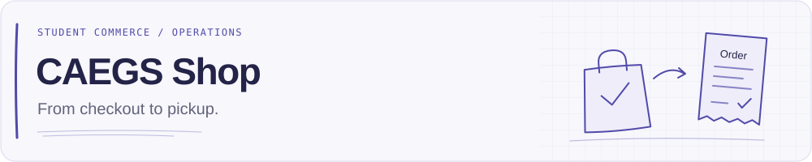
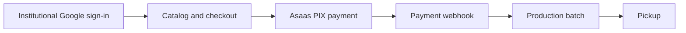

**English** · [Português](README.pt-BR.md)

<p align="center">
  <picture>
    <source media="(prefers-color-scheme: dark)" srcset="assets/readme/header-dark-en.svg">
    
  </picture>
</p>

# CAEGS Shop

A commerce and operations platform for **CAES, the Software Engineering Academic Center**. Students browse merchandise, pay through PIX and track their orders; the academic center manages the catalog, payments, production batches and pickup in one place.

The project connects the storefront to the work behind every order: institutional authentication, course eligibility, Asaas payment webhooks, fulfillment and operational reporting.

[Getting started](#03--local-development) · [Architecture](docs/architecture.md) · [Production deployment](docs/deployment.md)

## 01 / From checkout to pickup



| Area | What the platform handles |
| --- | --- |
| Access | Google OAuth / OIDC, institutional email validation, sessions and course-based purchase eligibility. |
| Storefront | Products, variants, images, announcements, cart and order tracking. |
| Payments | Asaas PIX checkout, webhook deduplication, status transitions and admin cancellation / refund flows. |
| Fulfillment | Paid orders grouped into production batches, pickup scheduling and tracking. |
| Operations | Dashboard, user and order management, reports, CSV exports and audit logs. |
| Data lifecycle | Configurable retention and privacy cleanup; Resend integration disabled by default in application settings. |

These areas have implementations in the repository. The API includes automated tests for authentication, orders, payments, webhooks, production, reports, email and privacy. The web test script is currently a placeholder. This describes the code; it does not certify production readiness.

## 02 / Engineering notes

| Layer | Technologies |
| --- | --- |
| Web | React 19, TypeScript, Vite, React Router, TanStack Query, Tailwind CSS, Lucide |
| API | Node.js 22, TypeScript, Fastify, Zod |
| Data | PostgreSQL 16, Prisma ORM |
| Integrations | Google OIDC, Asaas PIX, Resend |
| Runtime | pnpm workspaces, Docker Compose, Nginx |

The API checks identity, eligibility, prices and totals. Orders preserve product and price snapshots, payment and fulfillment have separate statuses, and webhook processing handles duplicate events.

```text
apps/web/              React storefront and administration
apps/api/              Fastify API and domain modules
packages/shared/       Shared schemas, types and constants
prisma/                Database schema, migrations and development seeds
docs/                  Architecture, operations and privacy notes
assets/readme/         Localized light/dark README headers
scripts/               Documentation asset generator
```

## 03 / Local development

Use **Node.js 22**, **pnpm 9.15.0** (pinned in `package.json`) and **Docker Compose**. Run commands from the repository root.

1. Copy `.env.example` to `.env`: `cp .env.example .env` in a POSIX shell, or `Copy-Item .env.example .env` in PowerShell.
2. Set `SESSION_SECRET` to a random value of at least 32 characters. Configure Google OAuth credentials, keeping `GOOGLE_REDIRECT_URI=http://localhost:3333/auth/google/callback` for local sign-in.
3. Install dependencies, start PostgreSQL and apply migrations:

```sh
corepack enable
pnpm install --frozen-lockfile
docker compose up -d postgres
pnpm db:generate
pnpm db:deploy
pnpm --filter @ca/shared build
pnpm dev
```

| Service | Local address |
| --- | --- |
| Web | http://localhost:5173 |
| API health | http://localhost:3333/health |
| Database health | http://localhost:3333/health/db |

An empty database needs courses and products before the purchase flow is useful. The existing development seed **clears application tables before inserting data**. Only for a disposable local database, load `.env` into the process and run the opt-in seed:

```sh
pnpm exec tsx --env-file=.env -e "process.env.ALLOW_DATABASE_RESET='true'; import('./prisma/seed.ts')"
```

The seed makes Software Engineering eligible to purchase and Computer Science ineligible. Sign-in requires a verified `sou.unijui.edu.br` or `unijui.edu.br` account. Initial administrators are promoted directly in the database; public registration and password login are outside the current scope.

For PIX, set `ASAAS_API_KEY` and `ASAAS_WEBHOOK_TOKEN`, keep `ASAAS_ENVIRONMENT=sandbox` locally, and configure Asaas to call a reachable `/webhooks/asaas` endpoint with the matching `asaas-access-token` header. In production the public path is `/api/webhooks/asaas`. Google sign-in and PIX require provider configuration; the setup above does not simulate them.

### Validation

```sh
pnpm typecheck
pnpm test
pnpm build
```

`pnpm test` runs the API suite; web and shared currently have placeholder test scripts. These checks do not replace sandbox validation of Google OAuth and Asaas.

## 04 / Deployment and documentation

- [Production deployment](docs/deployment.md): private services VM, PostgreSQL network, backups, migrations and reverse proxy configuration.
- [Privacy and retention](docs/privacy-and-retention.md): stored data, retention settings and cleanup.
- [Architecture plan](docs/architecture.md): domain boundaries and key flows. Some planned directory names differ from the current layout above.
- [Implementation decisions](docs/implementation-decisions.md): scope and technical constraints.
- [Prisma plan](docs/prisma-plan.md): database design notes.

The privacy guide also has English and Portuguese versions; the other technical guides are in English. The production workflow builds and transfers Docker images through WireGuard / SSH and calls a server-side deploy script. A push to `main` triggers it; review the workflow and deployment guide before publishing changes.

## 05 / Documentation and visual identity

English is the default repository language, with a [Portuguese README](README.pt-BR.md). Update both versions together. The student-facing interface uses Brazilian Portuguese and BRL.

The headers borrow the engineering notebook style of [LuizGabe's profile](https://github.com/LuizGabe): a quiet grid, indigo accents and sketches of merchandise and order paperwork. The focus here stays on the product and its operation.

English / Portuguese and light / dark variants are selected with `<picture>`. Regenerate them with Python 3, without external dependencies:

```sh
python scripts/generate_readme_assets.py
```
