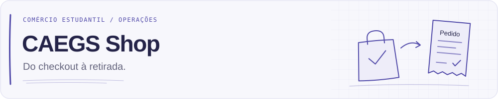
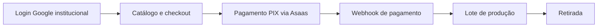

[English](README.md) · **Português**

<p align="center">
  <picture>
    <source media="(prefers-color-scheme: dark)" srcset="assets/readme/header-dark-pt-BR.svg">
    
  </picture>
</p>

# CAEGS Shop

Uma plataforma de comércio e operações para o **CAES, Centro Acadêmico de Engenharia de Software**. Os estudantes encontram produtos, pagam por PIX e acompanham seus pedidos; o centro acadêmico gerencia catálogo, pagamentos, lotes de produção e retirada em um só lugar.

O projeto conecta a loja ao trabalho por trás de cada pedido: autenticação institucional, elegibilidade por curso, webhooks de pagamento do Asaas, produção, retirada e relatórios operacionais.

[Primeiros passos](#03--desenvolvimento-local) · [Arquitetura](docs/architecture.md) · [Implantação em produção](docs/deployment.md)

## 01 / Do checkout à retirada



| Área | O que a plataforma gerencia |
| --- | --- |
| Acesso | Google OAuth / OIDC, validação de e-mail institucional, sessões e autorização de compra por curso. |
| Loja | Produtos, variantes, imagens, anúncios, carrinho e acompanhamento de pedidos. |
| Pagamentos | Checkout PIX via Asaas, deduplicação de webhooks, transições de estado e fluxos administrativos de cancelamento / reembolso. |
| Produção e retirada | Pedidos pagos agrupados em lotes, agendamento e acompanhamento de retirada. |
| Operação | Painel, gestão de usuários e pedidos, relatórios, exportações CSV e auditoria. |
| Ciclo de vida dos dados | Retenção configurável e limpeza de dados pessoais; integração Resend desabilitada por padrão nas configurações da aplicação. |

Essas áreas têm implementações no repositório. A API inclui testes automatizados de autenticação, pedidos, pagamentos, webhooks, produção, relatórios, e-mail e privacidade. O script de testes web ainda é um placeholder. Isso descreve o código, sem certificar que está pronto para produção.

## 02 / Notas de engenharia

| Camada | Tecnologias |
| --- | --- |
| Web | React 19, TypeScript, Vite, React Router, TanStack Query, Tailwind CSS, Lucide |
| API | Node.js 22, TypeScript, Fastify, Zod |
| Dados | PostgreSQL 16, Prisma ORM |
| Integrações | Google OIDC, Asaas PIX, Resend |
| Execução | Workspaces pnpm, Docker Compose, Nginx |

A API valida identidade, elegibilidade, preços e totais. Os pedidos preservam cópias dos produtos e preços, pagamento e produção têm estados separados, e o processamento de webhooks trata eventos duplicados.

```text
apps/web/              Loja e administração em React
apps/api/              API Fastify e módulos de domínio
packages/shared/       Schemas, tipos e constantes compartilhados
prisma/                Schema do banco, migrações e seeds de desenvolvimento
docs/                  Notas de arquitetura, operação e privacidade
assets/readme/         Cabeçalhos traduzidos para temas claro e escuro
scripts/               Gerador de recursos visuais da documentação
```

## 03 / Desenvolvimento local

Use **Node.js 22**, **pnpm 9.15.0** (fixado no `package.json`) e **Docker Compose**. Execute os comandos na raiz do repositório.

1. Copie `.env.example` para `.env`: `cp .env.example .env` em um shell POSIX, ou `Copy-Item .env.example .env` no PowerShell.
2. Defina `SESSION_SECRET` com um valor aleatório de pelo menos 32 caracteres. Configure as credenciais Google OAuth, mantendo `GOOGLE_REDIRECT_URI=http://localhost:3333/auth/google/callback` para login local.
3. Instale as dependências, inicie o PostgreSQL e aplique as migrações:

```sh
corepack enable
pnpm install --frozen-lockfile
docker compose up -d postgres
pnpm db:generate
pnpm db:deploy
pnpm --filter @ca/shared build
pnpm dev
```

| Serviço | Endereço local |
| --- | --- |
| Web | http://localhost:5173 |
| Saúde da API | http://localhost:3333/health |
| Saúde do banco | http://localhost:3333/health/db |

Um banco vazio precisa de cursos e produtos para viabilizar o fluxo de compra. O seed de desenvolvimento existente **limpa as tabelas da aplicação antes de inserir dados**. Somente em um banco local descartável, carregue o `.env` no processo e execute o seed com autorização explícita:

```sh
pnpm exec tsx --env-file=.env -e "process.env.ALLOW_DATABASE_RESET='true'; import('./prisma/seed.ts')"
```

O seed permite compras para Engenharia de Software e bloqueia para Ciência da Computação. O login exige uma conta verificada `sou.unijui.edu.br` ou `unijui.edu.br`. Os primeiros administradores são promovidos diretamente no banco; cadastro público e login por senha ficam fora do escopo atual.

Para PIX, defina `ASAAS_API_KEY` e `ASAAS_WEBHOOK_TOKEN`, mantenha `ASAAS_ENVIRONMENT=sandbox` localmente e configure o Asaas para chamar um endpoint `/webhooks/asaas` acessível com o cabeçalho `asaas-access-token` correspondente. Em produção o caminho público é `/api/webhooks/asaas`. Login Google e PIX exigem configuração dos provedores; o procedimento acima não os simula.

### Validação

```sh
pnpm typecheck
pnpm test
pnpm build
```

`pnpm test` executa a suíte da API; web e shared ainda têm scripts de teste placeholder. Essas verificações não substituem a validação de Google OAuth e Asaas em sandbox.

## 04 / Implantação e documentação

- [Implantação em produção](docs/deployment.md): VM privada de serviços, rede PostgreSQL, backups, migrações e configuração de proxy reverso.
- [Privacidade e retenção](docs/privacy-and-retention.pt-BR.md): dados armazenados, configurações de retenção e limpeza.
- [Plano de arquitetura](docs/architecture.md): limites dos domínios e fluxos principais. Alguns nomes de diretórios planejados diferem da estrutura atual acima.
- [Decisões de implementação](docs/implementation-decisions.md): escopo e restrições técnicas.
- [Plano Prisma](docs/prisma-plan.md): notas sobre o desenho do banco.

O guia de privacidade também tem versões em inglês e português; os demais guias técnicos estão em inglês. O workflow de produção gera e transfere imagens Docker por WireGuard / SSH e chama um script de implantação no servidor. Um push para `main` o dispara; revise o workflow e o guia de implantação antes de publicar alterações.

## 05 / Documentação e identidade visual

O inglês é o idioma padrão do repositório, com um [README em português](README.pt-BR.md). Atualize as duas versões em conjunto. A interface voltada aos estudantes usa português brasileiro e BRL.

Os cabeçalhos aproveitam o estilo de caderno de engenharia do [perfil LuizGabe](https://github.com/LuizGabe): quadriculado discreto, detalhes em índigo e esboços de produtos e documentos de pedidos. O foco aqui permanece no produto e na operação.

As variantes em inglês / português e para temas claro / escuro são selecionadas com `<picture>`. Regenere-as com Python 3, sem dependências externas:

```sh
python scripts/generate_readme_assets.py
```

## Licença

Distribuído sob a [licença MIT](LICENSE).
